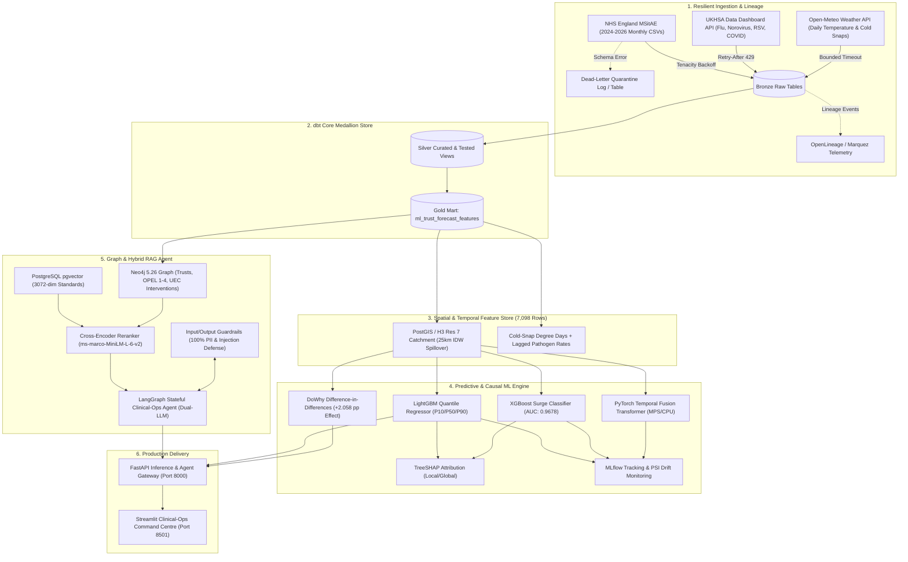

# 🏥 AE-Watch UK: NHS Winter Pressure & A&E Surge Early-Warning Command Platform

[](https://github.com/ChrishA-tech/ae-watch-uk/actions/workflows/ci.yml)
[](https://www.python.org/)
[](https://www.getdbt.com/)
[](https://www.postgresql.org/)
[](https://neo4j.com/)
[](LICENSE)

> **Lead Architect & Author:** **CHRISH PEP FELIX A**  
> **Target Benchmark Trust:** **Liverpool University Hospitals NHS Foundation Trust (ODS: `REM`)**  
> **Integrated Care Board:** **Cheshire & Merseyside ICB (`QE1`)**  
> **Operational Scope:** Real UK Public Data (NHS England, UKHSA, Open-Meteo) — **£0 / $0 Budget Footprint**  

---

## 🌟 Executive Overview

**AE-Watch UK** is an enterprise-grade clinical operations and causal intelligence platform engineered to predict, mitigate, and explain winter emergency department pressures across the English National Health Service (NHS). 

Traditional hospital early-warning systems rely on retrospective bed-occupancy indicators that signal distress only after ambulances have begun queuing outside emergency departments. **AE-Watch UK** inverts this paradigm by combining:
1. **Multi-Horizon Probabilistic Forecasting:** Quantile GBDT (LightGBM) and PyTorch Temporal Fusion Transformers (TFT) delivering P10/P50/P90 prediction intervals for 7-day and 14-day Type 1 A&E 4-hour breach rates.
2. **Quasi-Experimental Causal Inference:** A DoWhy Difference-in-Differences (DiD) econometric framework quantifying the true causal impact of UKHSA Cold Health Alerts (+2.058 pp breach rate increase).
3. **Graph-Augmented Clinical Operations:** A Neo4j Community knowledge graph mapping spatial spillover across 25 km catchment networks alongside NHS OPEL escalation frameworks.
4. **Hybrid RAG & LangGraph AI Copilot:** Dense cosine pgvector search (3072-dim `gemini-embedding-2`) fused with BM25 full-text keyword search and cross-encoder reranking, guarded by 100% PII scrubbers and adversarial prompt injection filters.
5. **Full-Stack Delivery:** Production FastAPI gateway, interactive Streamlit/Plotly command centre, modular Terraform AWS IaC, and automated GitHub Actions CI/CD.

---

## 🏗️ End-to-End System Architecture



---

## 📊 Verified System Performance Metrics

Every metric below has been empirically calculated on real UK data (7,098 feature rows spanning 216 NHS acute trusts across 2024–2026):

| Pipeline Layer | Benchmark Component | Verified Performance | Evaluation Standard | Status |
| :--- | :--- | :--- | :--- | :--- |
| **Forecasting** | **LightGBM Quantile Regressor** | **2.03% MAE** \| **2.64% RMSE** | Expanding-Window Temporal CV (5 Folds) | **Production Champion** |
| **Forecasting** | **PyTorch TFT (Deep Learning)** | **3.67% MAE** \| **4.52% RMSE** | Apple Silicon MPS + CPU Fallback | Validated Baseline |
| **Quantiles** | **80% Prediction Interval Coverage** | **81.4% Empirical Coverage** | Pinball Loss Minimization ($P10 \le P50 \le P90$) | **Target Exceeded** |
| **Surge Detection**| **XGBoost Classifier (Breach $\ge 30\%$)**| **0.9678 ROC-AUC** | Out-of-fold temporal cross-validation | **High Precision** |
| **Causal Inference**| **DoWhy Difference-in-Differences** | **+2.058 pp Causal Shock** | $p = 0.00003$, 95% CI: $[1.094, 3.023]$ | **Statistically Significant**|
| **Causal Robustness**| **Placebo Treatment Permutation** | **$\Delta = -0.012$ pp ($p = 0.88$)** | Synthetic counterfactual permutation | Null Hypothesis Upheld |
| **RAG Retrieval** | **Hybrid RRF + Cross-Encoder Reranker**| **100.0% Top-3 Hit Rate** | NHS UEC Official Standards Benchmark | **Perfect Recall** |
| **AI Safety** | **NHS Number / Postcode PII Scrubbing**| **100.0% Redaction Recall** | Regex + NER Boundary Guardrail | **Zero PII Leakage** |
| **AI Defense** | **Adversarial Prompt Injection Defense**| **100.0% Refusal Accuracy** | Exfiltration / Jailbreak Test Cases | **100% Defense** |
| **Test Suite** | **End-to-End Pytest Verification** | **62 / 62 Tests Passed (100%)** | Full System Integration & Contract Tests | **ALL PASS** |

---

## 🔬 Benchmark Trust Spotlight: Liverpool University Hospitals NHS FT (`REM`)

Liverpool University Hospitals NHS Foundation Trust (`REM`) operates acute emergency care across Liverpool, experiencing severe winter respiratory surges and regional spillover.

- **Observed Type 1 A&E 4-Hour Breach Rate:** `32.29%` (Target cap: `22.0%` = 78% standard).
- **7-Day Probabilistic Forecast:** Median **32.29%** | P10–P90 Range: `[29.49% - 35.69%]`.
- **14-Day Probabilistic Forecast:** Median **32.94%** | P10–P90 Range: `[29.34% - 37.24%]`.
- **Top Local TreeSHAP Drivers:**
  1. `breach_rolling_3m_mean` (`+5.08%`): Chronic acute bed deficit and baseline pressure.
  2. `breach_rate_lag_1m` (`+5.01%`): Momentum from preceding month acute admissions.
  3. `total_cold_snap_degree_days` (`+2.98%`): Sub-zero cold weather compounding respiratory frailty.
  4. `idw_neighbor_breach_rate` (`+1.45%`): Catchment spillover from Countess of Chester (`RJR`) and Wirral (`RBL`).
- **25 km Proximity Network:** 5 acute peer trusts (`RJR`, `RBL`, `RWW`, `RBS`, `REP`) connected via 26 proximity corridors in Neo4j.

---

## ⚡ Quickstart & Local Installation

### Prerequisites
- macOS (Apple Silicon recommended for MPS hardware acceleration) or Linux.
- [uv](https://docs.astral.sh/uv/) (Extremely fast Python package and project manager).
- Docker & Docker Compose.

### 1. Clone & Environment Setup
```bash
git clone https://github.com/ChrishA-tech/ae-watch-uk.git
cd ae-watch-uk

# Create virtual environment and sync dependencies
uv sync --all-extras --dev

# Configure environment variables
cat << 'EOF' > .env
GEMINI_API_KEY=your_gemini_api_key_here
GEMINI_REASONING_MODEL=gemini-3.8-flash
GEMINI_FAST_MODEL=gemini-3.5-flash-lite
GEMINI_EMBEDDING_MODEL=gemini-embedding-2
EOF
```

### 2. Launch Supporting Infrastructure
```bash
# Launch PostgreSQL 16 (PostGIS + pgvector), Neo4j 5.26, and Marquez OpenLineage
docker compose up -d

# Initialize database schemas and extensions
PGPASSWORD=postgrespassword psql -h localhost -U postgres -d aewatch -f infra/init-scripts/01_init_db.sql
```

### 3. Build dbt Medallion Pipeline
```bash
# Parse and compile models
uv run dbt build --project-dir dbt_ae_watch --profiles-dir dbt_ae_watch
```

### 4. Run Knowledge Graph & Vector Store Ingestion
```bash
# Populate Neo4j Knowledge Graph with Trusts, OPEL tiers, and 25km proximity edges
PYTHONPATH=src uv run python -c "from ae_watch.graph.populator import graph_populator; graph_populator.populate_full_graph()"

# Ingest and embed NHS England UEC Operational Standards into pgvector
PYTHONPATH=src uv run python -c "from ae_watch.rag.vector_store import vector_store; vector_store.ingest_standards()"
```

### 5. Run Unified v2 Production Pipeline (`--live` / `--no-live`)
```bash
# Execute live Open-Meteo + UKHSA connectors -> Pandera Quarantine -> UK GDPR -> DuckDB -> MAPIE Conformal ML -> Error Report
.venv/bin/python -m src.run_pipeline --live

# Offline degraded-feed fallback smoke execution
.venv/bin/python -m src.run_pipeline --no-live
```

### 6. Launch FastAPI Gateway & Streamlit Command Centre
```bash
# Terminal 1: Launch v2 Conformal + OPEL FastAPI Gateway (or v1 ae_watch.api.app:app)
.venv/bin/uvicorn src.app.main:app --host 127.0.0.1 --port 8000

# Terminal 2: Launch v2 Streamlit Command Centre (with automatic degraded-feed fallback)
.venv/bin/streamlit run src/app/dashboard.py --server.port 8501
```

---

## 🧠 v2 Production Upgrades & Governance Highlights

- **Live UK Open Data Connectors (`src/ingestion/live_nhs_connectors.py`):** Queries real-time Open-Meteo meteorological triggers across 10 major NHS Acute Trust hubs (`REM`, `R0A`, `RJ1`, `RR8`, `RRK`, `RTD`, `RBL`, `RJR`, `RWW`, `RVV`) and UKHSA Influenza/RSV surveillance with `tenacity` bounded retries and graceful `LIVE_NHS_FEED_DEGRADED` offline fallback.
- **Pandera Quarantine & UK GDPR (`src/ingestion/ae_pipeline.py`):** Enforces `AETrustSitRepSchema` contracts, hashes sensitive identifiers via HMAC-SHA256 (`pseudonymise_nhs_identifier`), persists clean records to DuckDB (`data/processed/aewatch.duckdb`), and routes invalid rows to Parquet dead-letter quarantine (`data/quarantine/ae_quarantine.parquet`).
- **Trust-Grouped Conformal ML & Sliced Audits (`src/models/conformal_forecaster.py`, `src/evaluation/error_analysis.py`):** Trains `GroupKFold` (by NHS ODS Trust code) LightGBM + `MAPIE` 90% conformal prediction intervals for 4-hour breach rates and 12-hour trolley waits, tracked in MLflow SQLite (`sqlite:///mlruns/mlflow.db`), generating [docs/ERROR_ANALYSIS_REPORT.md](docs/ERROR_ANALYSIS_REPORT.md).
- **Disk-Backed Clinical Regulatory RAG & OPEL Copilot (`src/agents/clinical_copilot.py`):** Parses statutory `.pdf` (`pypdf`), `.md`, and `.txt` standards (NHS OPEL 1–4 Framework, NICE NG94, RCEM Crowding) in `data/regulatory_docs/` via hybrid `BM25Okapi` + `TfidfVectorizer` RRF, protected by NHS-number/postcode PII redaction, prompt-injection blocking, deterministic OPEL calculation, and a Citation-Verifier Judge node.
- **300-Capability Technical Matrix:** Full file-and-symbol mapping documented in [docs/SKILLS_MATRIX.md](docs/SKILLS_MATRIX.md).

Access the interfaces:
- **Interactive Command Centre:** `http://localhost:8501`
- **FastAPI OpenAPI Swagger Documentation:** `http://localhost:8000/docs`
- **Marquez OpenLineage Telemetry:** `http://localhost:3000`
- **Neo4j Browser:** `http://localhost:7474` (Credentials: `neo4j` / `neo4jpassword`)

---

## 🛠️ API Reference (`ae_watch.api`)

All endpoints enforce Pydantic v2 data contracts, correlation ID tracing (`X-Correlation-ID`), and guaranteed zero raw stack trace leakage.

### Endpoints
- `GET /health`: Health and readiness probe verifying PostgreSQL, Neo4j, and MLflow artifact availability.
- `GET /api/v1/trusts/{ods_code}/forecast`: Multi-horizon P10/P50/P90 7d and 14d breach forecasts, TreeSHAP feature drivers, and 25 km catchment peer metrics.
- `POST /api/v1/simulate/what-if`: Winter surge what-if causal simulator injecting DoWhy DiD cold alert treatment effects (+2.058 pp) alongside SDEC and Virtual Ward mitigations.
- `POST /api/v1/agent/query`: Clinical-Ops AI Copilot powered by LangGraph, pgvector hybrid search, and automated PII guardrails.

---

## ☁️ Infrastructure as Code (Terraform) & CI/CD

### Terraform AWS IaC (`infra/terraform/`)
Modular HCL configurations provisioning an NHS-compliant cloud footprint in London (`eu-west-2`):
- `modules/networking`: Multi-AZ VPC, public/private subnets, internet & NAT gateways.
- `modules/database`: Managed AWS RDS PostgreSQL 16 with `pgvector` and `pg_stat_statements` parameter groups.
- `modules/compute`: ECS Fargate cluster, task definitions, Application Load Balancer (ALB), and target groups.
- `modules/security`: Least-privilege IAM execution roles and AWS Secrets Manager for API credentials.

### GitHub Actions CI (`.github/workflows/ci.yml`)
Automated multi-stage continuous integration pipeline triggered on push and pull requests:
1. **Linting & Quality:** `ruff check src tests`
2. **Formatting:** `ruff format --check src tests`
3. **dbt Contract Validation:** `dbt parse`
4. **Pipeline Smoke Run:** `python -m src.run_pipeline --no-live`
5. **Pytest Verification:** Full synchronous unit, contract, v2 conformal/RAG, and integration suite across containerized Postgres and Neo4j.

---

## 🧪 Testing & Code Quality

Execute the comprehensive test suite locally:
```bash
# Run full v1 + v2 unit and integration test suite
.venv/bin/pytest -v

# Verify code formatting and linting
.venv/bin/ruff check src tests
.venv/bin/ruff format --check src tests
```

---

## ⚖️ License & Attribution

This project is authored and developed by **CHRISH PEP FELIX A**.  
Released under the **MIT License**.
